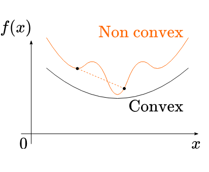
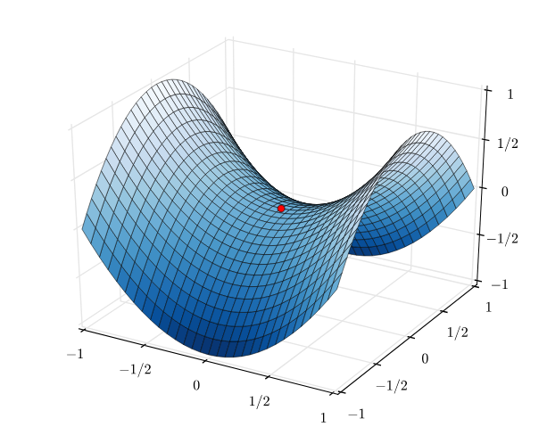
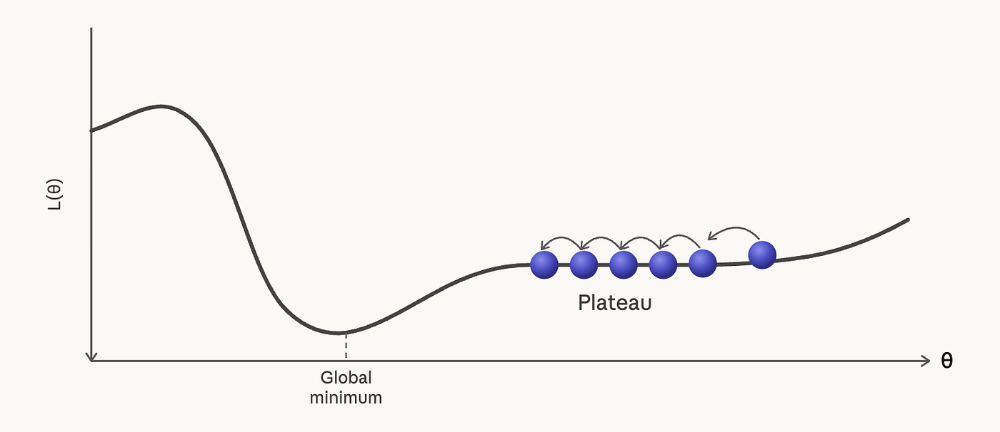
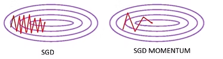

# Optimization(최적화)

- 함수의 파라미터를 조정하여 함수값의 최솟값 또는 최댓값을 찾는 과정
- "목적 함수(Objective Function)"(혹은 "손실 함수(Loss Function)")를 최소화하거나 최대화하는 파라미터 값을 찾는 문제
- 특정 문제에 대해 최적의 솔루션을 찾는 과정

## Optimization Problem의 기본 형태

일반적인 최적화 문제는 다음과 같이 표현할 수 있다.

$$
\min_{\theta} f(\theta)
$$

또는 제약 조건이 있는 경우,

$$
\min_{\theta} f(\theta) \quad \text{s.t.} \quad g_i(\theta) \le 0,\ h_j(\theta)=0
$$

- $f(\theta)$: 목적 함수
- $\theta$: 최적화할 변수 또는 파라미터
- $g_i, h_j$: 제약 조건

## Convex Optimization vs Non-convex Optimization

### Convex Function

- 함수 $f$가 convex하다는 것은 임의의 두 점 $x, y$와 $\lambda \in [0,1]$에 대해 다음이 성립

    $$
    f(\lambda x + (1-\lambda)y) \le \lambda f(x) + (1-\lambda)f(y)
    $$

    - 직관적으로는 두 점을 잇는 선분이 항상 함수 그래프 위에 있거나 같은 경우. 

- Convex optimization에서는 local minimum이 곧 global minimum이므로 최적화가 비교적 안정적

### Non-convex Function

- 딥러닝 모델의 손실 함수는 대부분 non-convex이므로, 최적화가 어려움. 
- 따라서 global minimum을 보장하기 어렵고, local minimum, saddle point, plateau 등의 문제가 발생할 수 있음.  

### Saddle Point(안장점)

<figure>
    
  <figcaption style="text-align: center;">Saddle Point의 시각적 예시, 함수의 특정 지점에서 모든 방향으로는 증가하지만, 다른 방향으로는 감소.</figcaption>
</figure>

- 함수의 특정 지점에서 모든 방향으로는 증가하지만, 다른 방향으로는 감소하는 지점
- 따라서 기울기를 기반으로 목적 함수를 최적화하는 알고리즘이 안장점에서 멈출 수 있음

### Plateau(평탄 지대)

<figure>
    
  <figcaption style="text-align: center;">Plateau의 시각적 예시, 함수의 특정 영역에서 기울기가 거의 0에 가까워지는 경우.</figcaption>
</figure>

- 함수의 특정 영역에서 기울기가 거의 0에 가까워지는 경우
- 안장점과 유사하게, 기울기를 기반으로 최적화하는 알고리즘이 이 영역에서 매우 느리게 수렴하거나 멈출 수 있음

## Gradient Based Optimization(경사 기반 최적화)
- 미분이 가능한 함수의 경우, 해당 함수의 그라디언트(gradient)를 이용하여 최적화하는 방법
- 그라디언트: 함수의 특정 지점에서 함수값이 가장 빠르게 증가하는 방향과 그 크기를 나타내는 벡터

### Gradient Descent(경사 하강법)
- 목적 함수의 그라디언트를 따라 파라미터를 업데이트하여 최솟값을 찾는 방법 
$$
\theta_{t+1} = \theta_t - \alpha \nabla f(\theta_t)
$$
    - $\theta_t$: t번째 반복에서의 파라미터 값
    - $\alpha$: 학습률(learning rate)
    - $\nabla f(\theta_t)$: 목적 함수의 그라디언트

- 목적 함수 $f$에 대해 값을 최소화하는 $\theta$를 찾는 문제
- 그라디언트란 함수의 특정 지점에서 함수값이 가장 빠르게 증가하는 방향을 나타내므로, 그 반대 방향으로 이동하면 함수값이 감소하게 됨

<figure>
    
  <figcaption style="text-align: center;">Gradient Descent의 시각적 예시, 그라디언트의 반대 방향으로 이동할 때 함수값이 감소.</figcaption>
</figure>

- 목적 함수가 볼록(convex)한 경우, 전역 최솟값(global minimum)을 보장하지만, 비볼록(non-convex)한 경우에는 지역 최솟값(local minimum)에 빠질 수 있음

<figure>
    
  <figcaption style="text-align: center;">Global Minimum과 Local Minimum</figcaption>
</figure>

- 얼마나 값을 업데이트할지 결정하는 학습률 $\alpha$의 선택이 중요
    - 너무 크면 발산(divergence)할 수 있고, 너무 작으면 수렴(convergence)이 느려질 수 있음

<figure>
    
  <figcaption style="text-align: center;">학습률이 너무 크거나 작은 경우의 예시</figcaption>
</figure>

### Newton's Method(뉴턴 방법)
- 목적 함수의 2차 미분(헤시안 행렬)을 이용하여 최적화하는 방법
$$
\theta_{t+1} = \theta_t - H^{-1} \nabla f(\theta_t)
$$
    - $\theta_t$: t번째 반복에서의 파라미터 값
    - $\nabla f(\theta_t)$: 목적 함수의 그라디언트
    - $H$: 목적 함수의 헤시안 행렬(2차 미분)

- 헤시안 행렬은 함수의 특정 지점에서의 곡률(curvature)을 나타냄
$$
H_{ij} = \frac{\partial^2 f}{\partial \theta_i \partial \theta_j} = \begin{bmatrix}
\frac{\partial^2 f}{\partial \theta_1^2} & \frac{\partial^2 f}{\partial \theta_1 \partial \theta_2} & \cdots & \frac{\partial^2 f}{\partial \theta_1 \partial \theta_n} \\
\frac{\partial^2 f}{\partial \theta_2 \partial \theta_1} & \frac{\partial^2 f}{\partial \theta_2^2} & \cdots & \frac{\partial^2 f}{\partial \theta_2 \partial \theta_n} \\
\vdots & \vdots & \ddots & \vdots \\
\frac{\partial^2 f}{\partial \theta_n \partial \theta_1} & \frac{\partial^2 f}{\partial \theta_n \partial \theta_2} & \cdots & \frac{\partial^2 f}{\partial \theta_n^2}
\end{bmatrix}
$$

- 곡률이 크다면 그 방향으로 더 빠르게 이동할 수 있고, 곡률이 작다면 더 천천히 이동해야 함
    - 즉, 함수를 감소시키기 위한 방향과 최적의 이동량을 동시에 고려하여 업데이트할 수 있음
    - 하지만, 계산 비용이 매우 큼 (헤시안 행렬의 계산복잡도는 $O(n^2)$, 역행렬 계산은 $O(n^3)$)
    - 특히 고차원, 대용량 데이터를 다루는 딥러닝 문제에서는 실용적이지 않음

### Stochastic Gradient Descent(확률적 경사 하강법)
- 전체 데이터셋의 그라디언트를 계산하는 것 역시 큰 계산비용이 소모됨
- 전체 데이터셋 대신, 무작위로 선택된 하나의 데이터 포인트(혹은 mini-batch)에 대한 그라디언트를 계산하여 파라미터를 업데이트하는 방법

    $$
    \theta_{t+1} = \theta_t - \alpha \nabla f_i(\theta_t)
    $$  
    - $f_i$: i번째 데이터 포인트에 대한 목적 함수
    - $\nabla f_i(\theta_t)$: i번째 데이터 포인트에 대한 그라디언트

- 전체 데이터셋에 대한 그라디언트를 계산하는 것보다 훨씬 빠르게 업데이트할 수 있음
- 하지만, 그라디언트의 추정이 노이즈가 많아져 수렴이 불안정할 수 있음

### Batch Gradient Descent vs SGD vs Mini-batch SGD

| 방법 | 업데이트 기준 | 장점 | 단점 |
|---|---|---|---|
| Batch Gradient Descent | 전체 데이터셋 | 안정적인 방향 | 계산 비용이 큼 |
| Stochastic Gradient Descent | 데이터 1개 | 빠른 업데이트 | 노이즈가 큼 |
| Mini-batch SGD | 일부 데이터 묶음 | 속도와 안정성의 균형 | batch size 선택 필요 |

실제 딥러닝에서는 대부분 Mini-batch SGD를 사용한다.

### Gradient Descent with Momentum(모멘텀을 이용한 경사 하강법)
- 그라디언트 업데이트에 모멘텀(momentum)이라는 개념을 도입하여, 이전 업데이트의 방향과 크기를 고려하여 현재 업데이트를 조정하는 방법

- **Exponential Moving Average(지수 이동 평균)**: EMA는 과거의 값들을 지수적으로 가중 평균하여 현재의 추정치를 계산하는 방법  

    $$
    v_{t} = \begin{cases}
    g_1 \quad \text{if } t = 1 \\
    \alpha v_{t-1} + (1 - \alpha) g_t \quad \text{if } t > 1
    \end{cases} ,\quad \theta_{t+1} = \theta_t - \eta v_t
    $$

    - $v_t$: t번째 반복에서의 모멘텀 벡터
    - $g_t$: t번째 반복에서의 그라디언트
    - $\alpha$: 모멘텀 계수(momentum coefficient). 이전 모멘텀의 영향을 얼마나 반영할지 결정하는 하이퍼파라미터
    - $\eta$: 학습률(learning rate)

- 모멘텀을 이용하면, 그라디언트가 노이즈가 많아도 업데이트 방향이 일관되게 유지되어 수렴이 더 안정적이고 빠르게 이루어질 수 있음
    
- 특히, 최적화 경로가 좁은 골짜기(narrow valley)를 지나는 경우, 모멘텀을 이용하면 더 빠르게 수렴할 수 있음

### Adagrad (Adaptive Gradient Algorithm)
- 각 파라미터마다 학습률을 개별적으로 조정하는 최초의 적응형 학습률 방법
- 지금까지 누적된 그라디언트 제곱합으로 학습률을 나눠, 자주 등장한 파라미터는 학습률을 줄이고 드물게 등장한 파라미터는 학습률을 키움

    $$
    G_t = G_{t-1} + g_t^2, \quad \theta_{t+1} = \theta_t - \frac{\eta}{\sqrt{G_t + \epsilon}} g_t
    $$

    - $G_t$: 시점 $t$까지의 그라디언트 제곱의 누적합
    - $\epsilon$: 분모가 0이 되는 것을 방지하는 작은 상수 (e.g. $10^{-8}$)

- 희소한(sparse) 데이터나 NLP 문제에서 효과적
- 하지만 $G_t$가 단조 증가하기 때문에, 학습이 진행될수록 학습률이 0에 수렴하여 학습이 멈추는 문제가 있음
- 이 문제를 해결하기 위해 RMSProp이 등장

### RMSProp (Root Mean Square Propagation)
- Adagrad의 각 파라미터마다 학습률을 개별적으로 조정하는 방법을 계승하고 단점을 이동 평균으로 해결한 방법
- 그라디언트의 제곱에 대한 지수 이동 평균을 유지하여, 자주 업데이트되는 파라미터의 학습률은 줄이고 드물게 업데이트되는 파라미터의 학습률은 늘림

    $$
    v_t = \beta v_{t-1} + (1 - \beta) g_t^2, \quad \theta_{t+1} = \theta_t - \frac{\eta}{\sqrt{v_t + \epsilon}} g_t
    $$

    - $v_t$: 그라디언트 제곱의 지수 이동 평균
    - $\beta$: 감쇠율(decay rate)
    - $\epsilon$: 분모가 0이 되는 것을 방지하는 작은 상수 (e.g. $10^{-8}$)

- 분모의 $\sqrt{v_t}$가 크면(그라디언트가 컸던 방향) 학습률이 작아지고, 작으면 학습률이 커짐
- Gradient Descent의 학습률 $\alpha$를 수동으로 잘 설정해야 하는 문제를 어느 정도 완화

### Adam Optimizer (Adaptive Moment Estimation)
- Momentum(1차 모멘트)과 RMSProp(2차 모멘트)을 결합한 방법으로, 현재 딥러닝에서 가장 널리 사용되는 옵티마이저

    $$
    m_t = \beta_1 m_{t-1} + (1 - \beta_1) g_t
    $$
    $$
    v_t = \beta_2 v_{t-1} + (1 - \beta_2) g_t^2
    $$

    - $m_t$: 그라디언트의 1차 모멘트 (방향 정보)
    - $v_t$: 그라디언트 제곱의 2차 모멘트 (크기 정보)
    - $\beta_1, \beta_2$: 각각 1차 모멘트와 2차 모멘트의 감쇠율

**Bias Correction(편향 보정)**  
초기 $t$가 작을 때 $m_t$, $v_t$가 0으로 초기화되어 있어 실제 값보다 작게 추정되는 문제를 보정:

$$
\hat{m}_t = \frac{m_t}{1 - \beta_1^t}, \quad \hat{v}_t = \frac{v_t}{1 - \beta_2^t}
$$

**최종 업데이트 식:**

$$
\theta_{t+1} = \theta_t - \frac{\eta}{\sqrt{\hat{v}_t} + \epsilon} \hat{m}_t
$$

- Momentum의 장점(안정적인 방향)과 RMSProp의 장점(파라미터별 학습률 적응)을 모두 가짐
- 대부분의 문제에서 별도의 튜닝 없이도 잘 동작함

### AdamW

- AdamW는 Adam에 Weight Decay를 올바르게 적용한 옵티마이저이다.

- 기존 Adam에서 L2 regularization을 적용하면 adaptive learning rate와 결합되면서 weight decay의 효과가 왜곡될 수 있다.  
- AdamW는 weight decay를 gradient update와 분리하여 적용한다.

- Adam의 기본 업데이트가 다음과 같다면,

    $$
    \theta_{t+1} = \theta_t - \frac{\eta}{\sqrt{\hat{v}_t}+\epsilon}\hat{m}_t
    $$

- AdamW는 여기에 weight decay 항을 분리하여 적용한다.

    $$
    \theta_{t+1} = \theta_t - \eta \left( \frac{\hat{m}_t}{\sqrt{\hat{v}_t}+\epsilon} + \lambda \theta_t \right)
    $$

    - $\lambda$: weight decay 계수

### Learning Rate Scheduler (학습률 스케줄러)
- 학습 초반에는 큰 학습률로 빠르게 수렴하고, 후반에는 작은 학습률로 세밀하게 최적점을 찾는 전략
- 고정된 학습률을 사용하는 것보다 더 좋은 성능을 내는 경우가 많음

대표적인 스케줄러 종류:

**Step Decay**: 일정 epoch마다 학습률을 일정 비율로 감소
$$
\eta_t = \eta_0 \cdot \gamma^{\lfloor t / s \rfloor}
$$
- $\gamma$: 감쇠 계수 (e.g. 0.1), $s$: decay step

**Cosine Annealing**: 학습률을 코사인 함수 형태로 부드럽게 감소
$$
\eta_t = \eta_{\min} + \frac{1}{2}(\eta_{\max} - \eta_{\min})\left(1 + \cos\frac{t\pi}{T}\right)
$$
- $T$: 전체 학습 스텝 수

**Warmup**: 학습 초반에 학습률을 0에서 목표값까지 선형으로 증가시킨 후 감소
- 초반 불안정한 그라디언트 업데이트를 방지하기 위해 Transformer 계열 모델에서 많이 사용됨